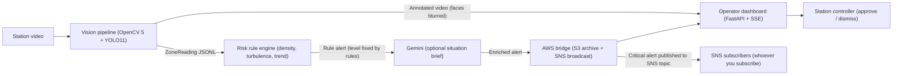

# Station Crowd Safety Agent

Computer-vision decision support for railway-station crowd safety. The system turns recorded station video into per-zone crowd density and turbulence measurements using **OpenCV 5** and a YOLO detector, applies deterministic safety rules, optionally adds a plain-English situation brief from Gemini, uploads evidence frames to **Amazon S3**, and publishes critical alerts to **Amazon SNS**, while presenting recommended actions to a human station controller for approval.

> **Status: working prototype.** The vision pipeline, risk agent, optional Gemini layer, AWS bridge (live or simulated) and operator dashboard run end to end on the bundled demo footage and on simulated scenarios. Zone areas are estimates, the pipeline runs offline at about 2 to 6 fps on a CPU, and detection accuracy has not been measured against labelled data. See [Evaluation](#evaluation) and [Limitations and safety notes](#limitations-and-safety-notes).

The system **supports human decision-making**. It does not control gates, trains or any other railway infrastructure.

---

## Architecture



The pipeline and agent communicate only through data contracts:

- [`crowd-agent-week2-start/contract/zone_reading.schema.json`](crowd-agent-week2-start/contract/zone_reading.schema.json) (pipeline to agent)
- [`agent/alert.schema.json`](agent/alert.schema.json) (agent to dashboard)

### Safety design

- **Rules make the safety call.** The risk level (`normal`, `watch`, `warning`, `critical`, `cant_trust`) comes only from the deterministic rule engine.
- **The LLM cannot change safety outcomes.** The Gemini enricher only adds `llm_summary` and `llm_source` to an alert (for Warning, Critical and Can't trust). It never alters the level, recommendation or triggers.
- **Works without cloud accounts.** Without `GEMINI_API_KEY`, the summary is a rule-based text (`llm_source: rule-synth`). Without AWS credentials, the S3/SNS bridge runs in simulation mode and only logs what it would have done. 
- **Privacy (best effort).** The head region of every detected person is blurred in the annotated video and evidence frames before display or upload. People the detector misses are not blurred, so this is not a guarantee. There is no face recognition.
- **No alert storms.** Critical alerts repeat every second while a condition lasts, so the SNS broadcast is limited to once per zone per 5 minutes and each evidence frame is uploaded to S3 once.

---

## Features

- **Person detection and zone density:** Ultralytics YOLO11 (`yolo11n.pt`, not an OpenCV module), with each person assigned to a zone by the bottom-centre of their bounding box. Counts in dense or distant scenes are a lower bound (see [Evaluation](#evaluation)).
- **Optical-flow turbulence and speed:** Farneback optical flow; camera motion is subtracted for handheld footage.
- **Trend regression:** a 60-second linear regression gives the density rate of change (people/m² per minute).
- **Optional Gemini situation brief** (model `gemini-3.8-flash`) for Warning, Critical and Can't trust alerts.
- **Amazon S3 evidence upload** and **Amazon SNS critical publish** (live with credentials, simulated without).
- **Human in the loop:** Warning and Critical alerts need operator approval. Critical alerts show a 60-second countdown that changes to "ESCALATED, awaiting human response" on the dashboard if nobody acts. It takes no automatic action.
- **Dashboard:** annotated video replayed in step with the zone cards, alert feed, and approve/dismiss actions.
- **Selectable demo profiles:** each bundles a video and a zone layout.

---

## Risk rules

Evaluated per zone, most severe first. Thresholds are constants at the top of [`agent/risk_agent.py`](agent/risk_agent.py) and are **starting values to tune, not validated safety limits**.

| Level | Trigger | Recommendation |
|---|---|---|
| **Can't trust** | confidence < 0.5, or flag `no_frame` / `camera_moved` | Send staff to check the area; never report all-clear |
| **Critical** | density ≥ 5 people/m², or (turbulence ≥ 0.5 and density ≥ 4) | Urgent hold on entry, deploy staff; 60 s countdown on the dashboard; SNS publish when raised |
| **Warning** | density ≥ 4 people/m², or rising ≥ 1.0 people/m²/min and projected to reach 4 within a minute | Stagger entry, announce an alternative route; needs approval |
| **Watch** | density 2 to 4 people/m², or rising > 0.5 people/m²/min | Highlighted on the dashboard |
| **Normal** | otherwise | Routine monitoring |

The trend is used only once 30 readings are available, and hysteresis stops a zone hovering on a threshold from flapping between levels. The 4 to 5 people/m² danger range follows commonly cited crush-risk figures.

---

## Quick start

### 1. Install

```powershell
git clone https://github.com/ITHA-SUNNY/Station-Crowd-Safety-Agent.git
cd Station-Crowd-Safety-Agent
py -m venv .venv
.venv\Scripts\activate
python -m pip install -r requirements.txt
```

On Linux or macOS, activate with `source .venv/bin/activate`. The first install downloads PyTorch via Ultralytics, so allow time and disk space. The YOLO weights (`yolo11n.pt`) download automatically on first use.

### 2. (Optional) Cloud credentials

```powershell
# Gemini situation briefs
$env:GEMINI_API_KEY = "your-gemini-api-key"

# Live S3 and SNS (otherwise the bridge simulates)
$env:AWS_ACCESS_KEY_ID = "your-aws-key"
$env:AWS_SECRET_ACCESS_KEY = "your-aws-secret"
$env:AWS_REGION = "ap-south-1"
$env:AWS_S3_BUCKET = "your-s3-bucket"
$env:AWS_SNS_TOPIC_ARN = "arn:aws:sns:ap-south-1:123456789012:railway-emergency-alerts"
```

Never commit credentials. `.env` files are git-ignored.

### 3. Run the dashboard

```powershell
python main.py                          # platform demo with video, replayed in real time, loops (default)
python main.py --scenario buildup       # simulated crush build-up: Watch, Warning, Critical alerts (10x, no video)
python main.py --scenario live_corridor # footbridge corridor demo, replayed in real time, loops
python main.py --video my_clip.mp4      # run the vision pipeline on your own video, then open the dashboard
python main.py --video my_clip.mp4 --profile corridor
```

The dashboard opens at <http://127.0.0.1:8000> (`--port` to change, `--no-browser` to skip opening it). Playback starts when the first browser connects.

- `buildup`, `normal` and `bad_camera` use scripted, simulated readings and have no video panel. `buildup` is the one that raises alerts. They play once.
- `live` and `live_corridor` replay readings that were measured earlier from the bundled demo footage, with the annotated video kept in sync. The pipeline itself runs offline (about 2 to 6 fps on a CPU); only the replay is in real time. The footage is low-density, and the detector undercounts distant crowds, so zones stay Normal.
- If a live scenario's data files are missing, `main.py` regenerates them from the profile's source video (a couple of minutes), or tells you what to supply.

### 4. Verify

```powershell
python main.py --test        # the three contract scenarios (normal, buildup, bad camera)
python main.py --test-llm    # Gemini enricher (rule-based fallback without a key)
python main.py --test-aws    # S3 and SNS bridge (simulation without credentials)
```

### Run the pipeline directly

```powershell
python pipeline/vision_pipeline.py --profile platform
python pipeline/vision_pipeline.py --profile corridor
```

Output goes to `live_readings.jsonl` and `output_annotated.mp4` for `platform`, or `live_readings_<profile>.jsonl` and `output_annotated_<profile>.mp4` otherwise. Options: `--video`, `--model`, `--out`, `--save-video`, `--no-blur`, `--show`.

To add a demo type, copy a file in `pipeline/profiles/`, edit the polygons (pixel coordinates), `zone_type`, `area_m2`, `camera_id` and `video`, then pass its name to `--profile`.

---

## Docker

A `Dockerfile` and `docker-compose.yml` are included for running the dashboard in a container (for example on AWS EC2, App Runner or ECS):

```powershell
docker compose up --build
```

Credentials are passed from your environment (see `docker-compose.yml`). The container starts the default `live` (platform video) scenario on port 8000. The Docker image has not been build-tested.

---

## Repository layout

```text
Station-Crowd-Safety-Agent/
├── main.py                     # unified launcher (dashboard, pipeline, tests)
├── Dockerfile, docker-compose.yml
├── requirements.txt
├── crowd.mp4, crowd_new.mp4    # CC-licensed demo footage (see Data and licences)
├── live_readings*.jsonl        # pipeline output for the demo footage
├── output_annotated*.mp4       # annotated demo video (zones overlaid, faces blurred)
├── pipeline/
│   ├── vision_pipeline.py      # YOLO11 + optical flow + face blurring
│   └── profiles/               # zone layouts: platform.json, corridor.json
├── agent/
│   ├── risk_agent.py           # rule engine and trend regression
│   ├── llm_enricher.py         # Gemini situation brief (optional)
│   ├── run_scenario.py         # contract regression scenarios
│   └── alert.schema.json
├── cloud/aws_bridge.py         # S3 evidence upload and SNS dispatch
├── dashboard/                  # FastAPI server (SSE + MJPEG) and static UI
├── docs/                       # evaluation.md and raw results
├── tools/                      # evaluate.py (benchmark) and zone-drawing helpers
└── crowd-agent-week2-start/
    ├── contract/               # ZoneReading schema and rule table
    └── mock/                   # scenario generator and JSONL files
```

---

## OpenCV 5

The project pins `opencv-python>=5.0,<6` and was developed and tested on OpenCV 5.0.0; the pipeline prints a warning if an older version is found. OpenCV does the video and image work. YOLO detection runs through Ultralytics.

| OpenCV 5 function | Used for |
|---|---|
| `VideoCapture`, `VideoWriter` | read demo video, write annotated video |
| `calcOpticalFlowFarneback` | dense optical flow, giving turbulence and speed per zone |
| `fillPoly`, `pointPolygonTest`, `polylines` | zone masks, assigning detections to zones, drawing zones |
| `GaussianBlur` | blur the head region of each detected person |
| `cvtColor`, `Laplacian` | grayscale for flow; brightness and blur checks that set confidence and quality flags |
| `addWeighted`, `putText`, `circle` | annotated overlay |
| `imencode` | JPEG frames for the dashboard video stream |

## Project status

| Area | State |
|---|---|
| Detection, zone counts, density, optical flow | Implemented (prototype) |
| Risk rules, recommendations, alert schema | Implemented; pass the three contract scenarios |
| Dashboard with approval and synced video | Implemented |
| Gemini brief, S3/SNS bridge | Implemented; live mode untested |
| Evaluation | Partly done: scenario behaviour and throughput measured, detection spot-checked by eye; no accuracy against labelled data |
| Real camera and floor calibration | Not done (zone areas are estimates) |
| Person tracking and smoothed counts | Not done |
| `no_frame` / `camera_moved` detection from real video | Not done (only simulated data exercises Can't trust) |
| Alert persistence | Not done |

## Evaluation

Full details, setup and caveats: [`docs/evaluation.md`](docs/evaluation.md). Reproduce with `python tools/evaluate.py`.

- **Rule behaviour (scripted scenarios):** the normal scenario raises 0 alerts. In `buildup`, FOB2 stairs reach Watch at 3:46, Warning at 7:45 and Critical at 9:49. In `bad_camera`, Can't trust is raised at 4:00, when the camera goes dark.
- **Throughput (CPU only, no GPU):** about 2.0 fps on both demo videos in an idle-machine run, with an earlier run at about 5.6 fps. This is below real time, so the pipeline runs offline here.
- **Detection:** a manual look at one frame per video found a clear undercount on the dense platform footage and a rough match on the corridor footage. Density from this detector is a lower bound in crowded scenes.
- **Not measured:** accuracy against labelled data, false alarms on real footage, and warning lead time on real incidents.

---

## Limitations and safety notes

- **Prototype only.** Not certified or validated for operational railway use or automated crowd control.
- **Human in the loop required.** Safety actions must be verified and carried out by human controllers.
- **Zone areas** (m²) are visual estimates for the demo footage, and the 35 px/m speed factor is a rough constant. Production use needs geometric camera calibration against measured station plans.
- **Detector limits.** YOLO misses people in dense crowds, under occlusion, in poor light and at long range. On the platform demo video it visibly undercounts, so measured density there is a lower bound.
- **The `corridor` profile** uses handheld, eye-level footage, so its turbulence values are noisy. It is a demonstration only.
- **Thresholds** and recommendations need testing before any real use.
- **Privacy.** No face recognition or identification. Only use footage you are permitted to use.

---

## Data and licences

Demo footage is committed so the live demos work after a clone. Both clips are Creative Commons licensed.

| File | Footage | Credit |
|---|---|---|
| `crowd_new.mp4` | "Crowd on Railway Station in India" by Footage Democracy, <https://youtu.be/r7-VchoIbG4> | CC BY: credit the creator when you publish results or media |
| `crowd.mp4` | Indian railway platform footage | Creative Commons licensed; creator credit to be added by the project owner |

`output_annotated*.mp4` are derived from these clips and carry the same licence terms.

**Code licence:** none is specified, so others have no automatic permission to reuse, modify or redistribute the code. Third-party model terms (Ultralytics YOLO) and the Gemini and AWS service terms apply separately.

---

## Contributing

1. Create a feature branch and keep changes focused.
2. Agree on shared JSON field names before changing a contract.
3. Run `python main.py --test` before opening a pull request into `main`.
4. Do not commit credentials, private data or unlicensed media.

## Team

| Workstream | Scope |
|---|---|
| Vision pipeline | Detection, zones, calibration, density, optical flow |
| Risk agent | Rules, trends, recommendations, Gemini brief, scenario evaluation |
| Dashboard and deployment | API, UI, approvals, AWS bridge, Docker, documentation |
