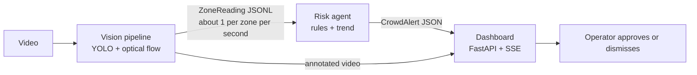

# Station Crowd Safety Agent

Computer-vision decision support for railway-station crowd safety. The system
turns recorded video into per-zone crowd measurements, applies explainable
risk rules, and presents recommended actions to a human operator for approval.

> **Status: working prototype.** The vision pipeline, risk agent and dashboard
> run end to end on recorded video and on mock scenarios. Zone areas and the
> pixel-to-metre speed factor are estimates, not a real calibration, and
> nothing has been validated against labelled data. See
> [Limitations](#limitations-and-safety-notes).

The system **supports human decision-making**. It does not control gates,
trains or any other railway infrastructure.

## Features

- **Person detection and zone counting** with Ultralytics YOLO and configurable
  zone polygons.
- **Density and motion measurement:** people per m², plus turbulence and flow
  speed from Farneback optical flow (camera motion is compensated for handheld
  footage).
- **Explainable risk levels:** Normal, Watch, Warning, Critical, and
  Can't trust. Every alert lists the rules that triggered it and a
  recommended action for the zone type.
- **Human in the loop:** Warning and Critical alerts require operator
  approval, and a low-confidence or failed camera is never reported as
  "all clear".
- **Live dashboard** with an annotated video panel (zones overlaid, faces
  blurred) kept in sync with the zone cards, an alert feed, and
  approve/dismiss actions.
- **Selectable demo profiles:** each bundles a video and a zone layout.

## How it works



The pipeline and agent communicate only through the data contract in
[`crowd-agent-week2-start/contract/`](crowd-agent-week2-start/contract/README.md)
(`zone_reading.schema.json`), so each side can be developed and tested
independently with mock data.

### Risk rules

Evaluated per zone, most severe first. Thresholds live as constants at the top
of [`agent/risk_agent.py`](agent/risk_agent.py).

| Level | Trigger | Agent action |
|---|---|---|
| Can't trust | confidence < 0.5, or flag `no_frame` / `camera_moved` | Ask a human to check the camera |
| Critical | density ≥ 5 p/m², or turbulence ≥ 0.5 with density ≥ 4 | Urgent recommendation, escalate if not approved in 60 s |
| Warning | density ≥ 4 p/m², or rising ≥ 1.0 p/m²/min and projected to reach 4 within a minute | Recommend an action, ask an official to approve |
| Watch | density 2 to 4 p/m², or rising > 0.5 p/m²/min | Show on dashboard, no alert |
| Normal | otherwise | Keep watching |

The trend is a linear regression over a 60 s window and is only used once 30
readings are available. Hysteresis stops a zone hovering on a threshold from
flapping between levels. The danger thresholds follow the commonly cited
4 to 5 people/m² crush-risk range and are **starting values to be tuned, not
validated safety limits**.

## Quick start

Requires Python 3 and Git. The first install downloads PyTorch via
Ultralytics, so allow time and disk space.

```cmd
git clone https://github.com/ITHA-SUNNY/Station-Crowd-Safety-Agent.git
cd Station-Crowd-Safety-Agent
py -m venv .venv
.venv\Scripts\activate
python -m pip install -r requirements.txt
```

On Linux or macOS, activate with `source .venv/bin/activate` instead.

The YOLO weights (`yolo11n.pt`) download automatically on first use, or fetch
them explicitly:

```cmd
python -c "from ultralytics import YOLO; YOLO('yolo11n.pt')"
```

### 1. Try the agent on mock data (no video needed)

```cmd
python agent/run_scenario.py
```

Runs three scenarios (normal, buildup, bad camera) and prints a PASS/FAIL
summary against the expected behaviour in the contract.

### 2. Run the vision pipeline on a demo profile

Videos are not stored in the repository. Place the file named in the profile
in the repository root, then run the pipeline:

| Profile | Video file | Camera | Zones |
|---|---|---|---|
| `platform` (default) | `crowd.mp4` (supply your own permitted footage) | fixed | FOB stairs, two platform edges, two waiting areas |
| `corridor` | `crowd_new.mp4` (see [Data and licences](#data-and-licences)) | handheld | far, mid and near footbridge bands |

```cmd
python pipeline/vision_pipeline.py --profile platform
python pipeline/vision_pipeline.py --profile corridor
```

Output goes to `live_readings.jsonl` (platform) or
`live_readings_<profile>.jsonl`, plus an annotated video
(`output_annotated*.mp4`) and evidence frames in `pipeline/frames/`. Useful
options: `--video`, `--model`, `--out`, `--save-video`, `--no-blur`,
`--show` (press `q` to close the preview).

**Adding a demo type:** copy a file in `pipeline/profiles/`, edit the polygons,
`zone_type`, `area_m2`, `camera_id` and `video`, then pass its name to
`--profile`. Polygon coordinates are pixels in the video frame.

### 3. Start the dashboard

```cmd
python dashboard/server.py --scenario live_platform
```

Open <http://127.0.0.1:8000>.

| `--scenario` | Source |
|---|---|
| `live_platform`, `live_corridor` | Replays pipeline output with the synced video panel (run step 2 first) |
| `normal`, `buildup`, `bad_camera` | Mock scenarios from the contract, no video |

Playback starts when the first browser connects. `live_*` scenarios run in
real time and loop (`--no-loop` to play once); mock scenarios run at 10×.
Use `--speed` to change the rate and `--port` if 8000 is busy. The `buildup`
scenario is the best way to see Watch, Warning and Critical alerts.

## Repository layout

```text
Station-Crowd-Safety-Agent/
├── pipeline/
│   ├── vision_pipeline.py        # video -> ZoneReading JSONL + annotated video
│   └── profiles/                 # demo types: video + zone layout (JSON)
├── agent/
│   ├── risk_agent.py             # ZoneReading -> CrowdAlert (rule engine)
│   ├── run_scenario.py           # scenario runner with PASS/FAIL checks
│   └── alert.schema.json         # CrowdAlert schema
├── dashboard/
│   ├── server.py                 # FastAPI, SSE and video stream
│   └── static/index.html         # operator UI
├── crowd-agent-week2-start/
│   ├── contract/                 # ZoneReading schema and rule table
│   └── mock/                     # scenario generator and JSONL files
├── requirements.txt
└── .gitignore
```

## Project status

| Area | State |
|---|---|
| YOLO detection, zone counts, density | Implemented (prototype) |
| Optical-flow turbulence and speed | Implemented (camera motion compensated for handheld profiles) |
| Risk rules, recommendations, alert schema | Implemented, passes the mock scenarios |
| Dashboard with approval and synced video | Implemented |
| Real camera and floor calibration | Not done (zone areas are estimates) |
| Person tracking and smoothed counts | Not done |
| `no_frame` / `camera_moved` detection from real video | Not done (only mock data exercises these paths) |
| Evaluation against labelled data | Not done |
| Alert persistence and cloud deployment | Not done |

## Evaluation plan

Planned measures, to be reported only once actually run:

- Person-count error against ground truth.
- Warning lead time before peak density in test videos.
- False alarms and missed warnings on test scenarios.
- Processing time and frames per second on documented hardware.
- Failure cases: occlusion, poor lighting, dense crowds, camera movement.

## Limitations and safety notes

- Not validated for operational railway safety use.
- Detectors miss people in dense crowds, under occlusion, in poor light and at
  long range. Counts in very dense scenes will be too low.
- Pixel measurements are not physical densities until perspective and
  real-world floor dimensions are calibrated. The shipped zone areas and the
  35 px/m speed factor are estimates.
- The `corridor` profile uses handheld, eye-level footage, so its turbulence
  values are noisy. It is a demonstration only.
- Risk thresholds and recommendations need testing before any real use.
- Human review must remain in the loop. The prototype must never directly
  control real gates, trains or other railway systems.
- **Privacy:** no face recognition or identification. Faces are blurred in
  annotated video and evidence frames. Only use footage you are permitted to
  use.
- Do not commit credentials, private footage or other sensitive data.

## Data and licences

Large media and model weights are excluded from Git (see `.gitignore`).
Document the source and licence of any footage you use, and do not publish
third-party media or weights unless redistribution is allowed.

**Corridor demo footage:** "Crowd on Railway Station in India" by Footage
Democracy, <https://youtu.be/r7-VchoIbG4>, licensed Creative Commons
Attribution (CC BY). Credit the creator if you publish results or media. One
way to fetch the video-only stream used by the `corridor` profile:

```cmd
python -m pip install yt-dlp
python -m yt_dlp -f 136 -o crowd_new.mp4 https://youtu.be/r7-VchoIbG4
```

**Code licence:** none is currently specified, so others have no automatic
permission to reuse, modify or redistribute the code. Third-party video,
dataset and model terms (including Ultralytics YOLO) are separate.

## Contributing

1. Create a feature branch for your work and keep changes focused.
2. Agree on shared JSON field names before changing the contract.
3. Test against the mock scenarios (`python agent/run_scenario.py`) before
   opening a pull request into `main`.
4. Do not commit credentials, private data, large outputs or unlicensed media.

## Team

| Workstream | Scope |
|---|---|
| Vision pipeline | Detection, zones, calibration, density, optical flow |
| Risk agent | Rules, trends, recommendations, scenario evaluation |
| Dashboard and deployment | API, UI, approvals, documentation, deployment |
