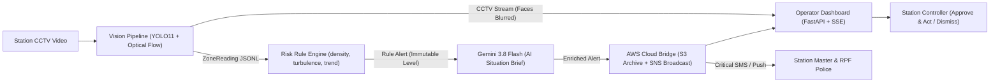

# Station Crowd Safety Agent

Computer-vision decision support for railway-station crowd safety. The system turns recorded or live CCTV video into per-zone crowd density and turbulence measurements, applies safety-first risk rules, generates plain-English situational briefs via **Gemini 3.8 Flash**, archives blurred evidence to **Amazon S3**, and dispatches emergency broadcasts via **Amazon SNS** while presenting actionable recommendations to a human station controller for approval.

> **Status: working prototype.** The vision pipeline, risk agent, Gemini explanation layer, AWS cloud bridge, and operator dashboard run end-to-end on recorded video and simulated edge-case scenarios. See [Limitations and Safety Notes](#limitations-and-safety-notes).

The system **supports human decision-making**. It does not control gates, trains or any other railway infrastructure.

---

## Architecture



The pipeline and agent communicate strictly through data contracts:
- [`crowd-agent-week2-start/contract/zone_reading.schema.json`](crowd-agent-week2-start/contract/zone_reading.schema.json)
- [`agent/alert.schema.json`](agent/alert.schema.json)

### Safety-First Architecture & LLM Contract
- **Rules always make the safety call**: Risk level (`normal`, `watch`, `warning`, `critical`, `cant_trust`) is determined strictly by the deterministic rule engine.
- **LLM cannot downgrade safety**: The Gemini LLM enricher only writes to `alert["llm_summary"]`. It can never alter the alert level, recommendation, or sensor triggers.
- **Privacy compliance**: All evidence frames and live video feeds have human faces blurred before display or cloud archiving.
- **Enterprise Cloud Bridge**: Dual-mode AWS bridge; automatically runs in live mode with valid AWS credentials or in zero-friction simulation mode for local demos.

---

## Features

- **Person detection & zone density**: Ultralytics YOLO11 (`yolo11n.pt`) with bottom-center ground-plane attribution.
- **Optical flow turbulence**: Farneback optical flow measures chaotic vs smooth crowd movement.
- **Rolling trend regression**: 60-second linear regression computes density rate of change ($\text{people/m}^2/\text{min}$).
- **Gemini 3.8 Flash AI Situation Brief**: Explains emerging crush risks in plain English for the operator on duty.
- **Amazon S3 Evidence Archiving**: Automatically stores privacy-blurred evidence frames to cloud storage for tamper-evident safety audits.
- **Amazon SNS Emergency Dispatch**: Immediately pushes emergency broadcasts to station masters and railway police when critical crush thresholds are exceeded.
- **Human-in-the-loop**: Warning and Critical alerts require operator approval, with a 60-second escalation countdown timer on Critical alerts.
- **Live web dashboard**: Synchronized CCTV video view, live zone status cards, and interactive approval workflow.

---

## Risk Rules

| Level | Trigger Criteria | Action Recommendation |
|---|---|---|
| **Can't trust** | Confidence < 0.5, or `no_frame` / `camera_moved` | Deploy staff to visually check the area. Never report all-clear. |
| **Critical** | Density $\ge 5\text{ p/m}^2$, or (Turbulence $\ge 0.5$ AND Density $\ge 4$) | Urgent hold on entry gates, deploy stairhead staff, 60s escalation timer, SNS broadcast |
| **Warning** | Density $\ge 4\text{ p/m}^2$, or rising $\ge 1.0\text{ p/m}^2/\text{min}$ toward 4 | Stagger gate entry, announce alternate foot overbridges via PA |
| **Watch** | Density $2\text{--}4\text{ p/m}^2$, or trend $> +0.5\text{ p/m}^2/\text{min}$ | Highlighted on dashboard for close monitoring |
| **Normal** | Density $< 2\text{ p/m}^2$ and Turbulence $< 0.3$ | Routine monitoring |

---

## Quick Start

### 1. Installation

```powershell
git clone https://github.com/ITHA-SUNNY/Station-Crowd-Safety-Agent.git
cd Station-Crowd-Safety-Agent
python -m pip install -r requirements.txt
```

### 2. (Optional) Configure Cloud Credentials

```powershell
# For Gemini 3.8 Flash AI Situation Briefs:
$env:GEMINI_API_KEY = "your-gemini-api-key"

# For live Amazon S3 & Amazon SNS integration (optional):
$env:AWS_ACCESS_KEY_ID = "your-aws-key"
$env:AWS_SECRET_ACCESS_KEY = "your-aws-secret"
$env:AWS_REGION = "ap-south-1"
$env:AWS_S3_BUCKET = "your-s3-bucket"
$env:AWS_SNS_TOPIC_ARN = "arn:aws:sns:ap-south-1:123456789012:railway-emergency-alerts"
```
*(If AWS credentials are not set, the system automatically runs in safe simulation mode).*

### 3. Launch Master Runner (`main.py`)

Run the complete operator dashboard in one command:

```powershell
# 1. Crowd crush buildup scenario with CCTV video, Gemini briefs & AWS archiving (default, 10x speed)
python main.py

# 2. Real-time Indian railway platform CCTV playback
python main.py --scenario live

# 3. Footbridge corridor CCTV playback
python main.py --scenario live_corridor

# 4. Process new footage with YOLO11 and open dashboard
python main.py --video crowd.mp4

# 5. Run verification test suite (all 3 contract scenarios)
python main.py --test

# 6. Verify Gemini 3.8 Flash AI enricher
python main.py --test-llm

# 7. Verify Amazon S3 & SNS cloud integration
python main.py --test-aws
```

The master launcher automatically opens [http://127.0.0.1:8000](http://127.0.0.1:8000) in your browser.

---

## Cloud & Docker Deployment

A production `Dockerfile` and `docker-compose.yml` are included for deploying on **AWS EC2**, **AWS App Runner**, or **AWS ECS**:

```powershell
docker compose up --build
```

---

## Repository Layout

```text
Station-Crowd-Safety-Agent/
├── main.py                     # Master unified launcher CLI
├── Dockerfile                  # Container definition for AWS deployment
├── docker-compose.yml          # Container configuration with cloud environment variables
├── requirements.txt            # Python dependencies (YOLO, OpenCV, FastAPI, google-genai, boto3)
├── crowd.mp4                   # Sample Indian railway station platform footage
├── pipeline/
│   ├── vision_pipeline.py      # YOLO11 + Farneback optical flow + face blurring
│   ├── profiles/               # Zone layouts: platform.json, corridor.json
│   └── frames/                 # Stored evidence frames (faces blurred)
├── agent/
│   ├── risk_agent.py           # Deterministic rule engine & linear trend regression
│   ├── llm_enricher.py         # Gemini 3.8 Flash situational explanation layer
│   ├── run_scenario.py         # Automated contract regression test suite
│   └── alert.schema.json       # CrowdAlert contract schema
├── cloud/
│   └── aws_bridge.py           # Amazon S3 evidence archiving & Amazon SNS emergency dispatch
├── dashboard/
│   ├── server.py               # FastAPI backend with SSE alert stream & MJPEG video
│   └── static/index.html       # Single-page operator dashboard (responsive dark UI)
└── crowd-agent-week2-start/
    ├── contract/               # Input/output schemas & specification
    └── mock/                   # Scenario generators & test datasets
```

---

## Limitations and Safety Notes

- **Prototype only:** Not certified for operational deployment in live railway signaling or automated crowd control.
- **Human in the loop required:** Safety actions must always be verified and executed by human controllers.
- **Zone areas:** Zone areas ($\text{m}^2$) and homography are visual approximations calibrated for test footage; production deployment requires geometric camera calibration against measured station blueprints.
